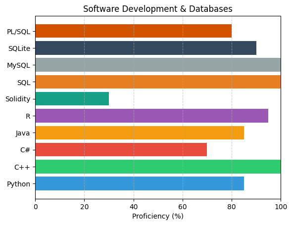
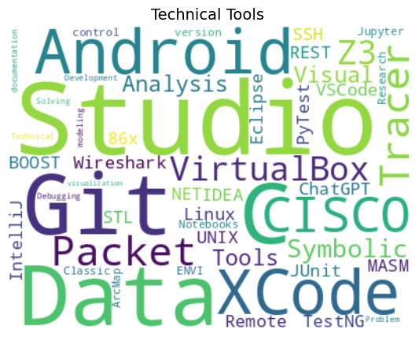

  

<h1 align="center">Ali Hassan</h1>

   📧 malihassanahmad@gmail.com | 🌐 <a href="https://github.com/theAliHassan">GitHub</a> | 💼 <a href="https://www.linkedin.com/in/thealihassanahmad/">LinkedIn</a>

## 🚀 About Me

- Software Developer | Machine Learning Developer | Data Scientist
- Proficient in Python, C++, C#, Java, R, and more.
- Skilled in databases, including MySQL, SQL Server, and Firebase.
- Experienced with TensorFlow, PyTorch, and FAST.AI for machine learning.

## 💼 Professional Experiences

### Machine Learning Developer

- **CyberDiverge** | Present
  - Led machine learning development efforts.
  - Integrated machine learning, data analysis, and infrastructure components.
  - Achieved 85% accuracy in sentiment classification using NLP techniques.

### Software Developer

- **TPI – LUMS** 
  - Led a project to enhance Symbolic Execution-based Smart Contract Analysis Tools.
  - Introduced industry-standard benchmarking methods and reduced false positives.

### Deep Learning Engineer

- **EPTeck Technologies Pvt. Ltd.** 
  - Developed cutting-edge Image Classification models using FAST.AI and PyTorch.
  - Engineered a robust Text Prediction Model for movie reviews.
  - Led end-to-end data analysis projects, delivering actionable insights.

## 🎓 Education

- B.S. Computer Science 
  National University of Computer and Emerging Sciences [NUCES – FAST]

## 🏆 Achievements

- Dean’s List Award: Spring 2019, Spring 2017, Fall 2016

## 🏆 Software Development and Databases

<table>
  <tr>
    <td></td>
    <td></td>
  </tr>
</table>

## Let's Connect 🔥

  
  
  
  

